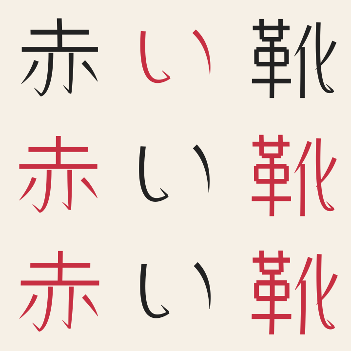

# FLAMORIS Glyph

**同じ文字が、同じ形である必要はない。**

曲の世界観を共有しながら、文字の登場箇所ごとに形を変える、楽曲専用ベクターレタリングエンジン。

**Status: offline MVP (0.2).** Python library / CLIで、歌詞・SRT → 出現箇所 → Style DNA → 輪郭SVG＋JSON bundleを生成できます。Windows / Linux共通。AIによるデザイン提案、MCP公開、KineticTypo側の読込・再生は未実装です。

## What it owns

- 歌詞の文字一覧と、各文字の出現ID・cue時刻との対応
- Song Style DNA、制限内での字形変化、明示的な字形再利用
- 静的TTF/OTFの輪郭取出し、または明示されたストローク骨格からの輪郭生成
- フォント不要で再生できるSVGと、バージョン付き共通manifest
- 出力の検証と、見た目を確認するSVGコンタクトシート

KineticTypoは配置・動き・描画・タイムラインを所有します。Glyphは他アプリのprojectやUndo/Redoを変更しません。AI実行・モデル・GPU・サービス運用は外部の生成基盤が所有します。

## Quick start (Linux / Windows)

Python 3.11+。GPU・GUI・システムフォントは不要です。

```bash
python -m venv .venv
# Linux: source .venv/bin/activate
# Windows PowerShell: .venv\Scripts\Activate.ps1
python -m pip install -e .
python -m flamoris_glyph.cli generate examples/demo.srt --song "Red Shoes experiment" --skeletons examples/skeletons.json --style examples/tango.style.json --seed 42 --out output-demo
python -m flamoris_glyph.cli validate output-demo
python -m flamoris_glyph.cli preview output-demo --out demo-preview.svg
python -m unittest discover -s tests -v
```

`out`には新しいディレクトリを指定してください。失敗途中のbundleは公開せず、既存ディレクトリは上書きしません。`preview`も既存ファイルを上書きしません。コンタクトシートは先頭96文字までです。



これはオリジナルの簡略骨格を使った実験です。実曲の歌詞・タイミングではありません。

## Arbitrary Japanese lyrics

実際の日本語歌詞には、アウトライン化して作品に利用できる**静的な日本語TTF/OTF**を指定します。フォントファイルは出力に含めません。利用条件は指定フォントに従います。

```bash
python -m flamoris_glyph.cli generate lyrics.srt --song "My song" --font path/to/static-japanese.otf --source-license "Font name, license and source URL" --style examples/tango.style.json --seed 42 --out song-glyphs
```

未収録文字はエラーにします。別フォントへの無言の差し替えは行いません。フォント輪郭は筆順情報ではないため、そこから「とめ・はね・はらい」を自動認識したとは扱いません。ストロークごとに編集したい場合は、明示的な骨格入力を使います。

## Same character, different performance

既定の`--reuse occurrence`は文字の出現ごとに別variantを生成します。`--reuse character`は同じ文字のvariantを明示的に再利用します。`--title`は時刻なしの追加文字として扱います。

Style DNAが共有するものは色・基本比率・傾き・変形幅、骨格入力時の太さ・終端ルールです。`variation`（0..1）を上げると、幅・高さ・傾き・曲がり・骨格の太さが決められた範囲で変化します。0なら同じ文字の輪郭と色は一致します。色は指定paletteの中から選びます。これは生成の制約であり、美的な一貫性や可読性の自動評価ではありません。仕上がりはプレビューで確認します。

同じ入力・style・seed・source・generator/dependency versionで再現できます。出現IDはcue順・可視文字順から決まり、歌詞を挿入すると後続IDが変わる場合があります。

## Export and integration

```text
song-glyphs/
  manifest.json
  glyphs/g<variant-id>.svg
```

SVGは1000×1000の共通座標と閉じた塗りパスのみ。`text`、画像、外部リンク、script、filterを含みません。Manifestのasset pathは常に相対パス・スラッシュ区切りです。元フォント・OS・Pythonは再生側に不要です。

Python API: `parse_cues` → `compile_bundle` → `write_bundle`。CLIや将来のMCP adapterも同じcoreを使う設計です。MCP transportを独自実装していません。

従来のinventory CLIは維持しています。以下はschema 1の文字一覧のみを出力します。

```bash
python -m flamoris_glyph.cli lyrics.srt --song "My song" --out inventory.json
```

[Architecture](docs/architecture.md) · [Bundle contract](docs/bundle-v2.md) · [Style / skeleton input](docs/inputs.md)

## Supported boundary

- UTF-8（BOM可）、LF / CRLF、plain text / SRT。SRTの数値歌詞は保持し、cue時刻をms整数で出力。文字単位の歌唱時刻は推測しません。
- NFC正規化後の単一codepoint。未結合の結合文字、variation selector、ZWJ、skin-tone / flag sequencesは明示的に拒否。複雑なshaping、kerning、縦組み、ruby、variable/color fonts、TTC、網羅的な日本語骨格データは未対応。
- 骨格は文字ごとに明示して用意します。デモの4字を全文字対応とは扱いません。AIによる字形生成・参考画像からの骨格抽出・部首自動分解は今後の段階です。
- Windows / Linuxの同じテストをCIで実行。キネタイ実機の同一描画検証は、各player adapter実装後に行います。

## License / FLAMORIS

Code and original experimental skeleton samples: [Apache License 2.0](LICENSE).
The fontTools dependency is MIT licensed. No third-party fonts, models or stroke datasets are included.
Font-derived artwork remains subject to the supplied font's license; recording a license note is provenance, not automated legal verification.

FLAMORIS is open-source creative software. Commercial use is welcome within applicable licenses. Software is provided as-is, without guaranteed individual support.

