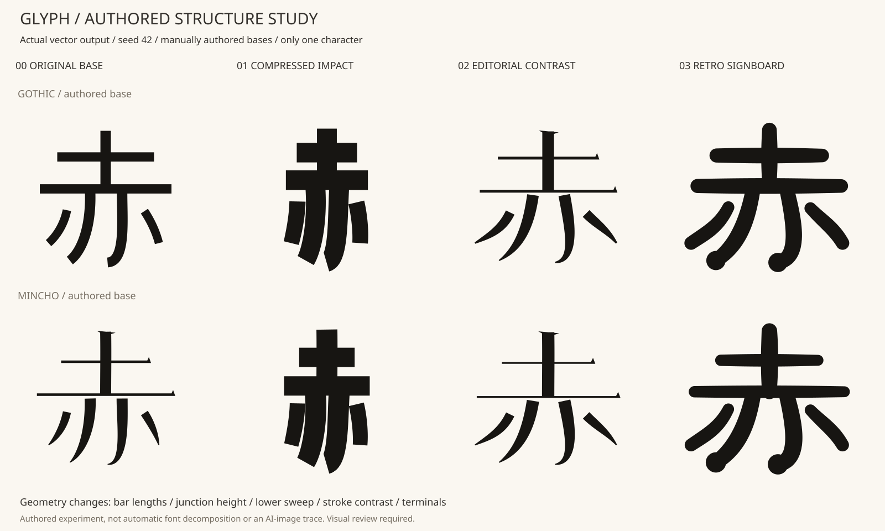

# Authored structure study: 赤 × two bases × three DNA profiles

Status: one-character experiment, in the same unmerged research PR as the
earlier outline experiment. Inspired by the approved AI concept artwork's
visible differences in construction, not just thickness. **The image was
interpreted by the author; the code does not trace it or learn a transform.**



## What changed from the first experiment

The first outline pass could mostly change width, weight and rounding. Here,
the source explicitly identifies seven roles: top bar, top stem, main bar,
inner left/right, outer left/right. The existing original sample informed the
hand-authored cubic centerlines in `examples/aka-structure.json`.

The two sources are **original gothic-like and mincho-like experimental
drawings**, not extracted existing fonts. They differ in horizontal/vertical
width ratio, initial bar coordinates, taper and terminal ornaments. No font
binary or external stroke dataset is included or downloaded.

The SAME Structure DNA settings and seed are applied to both bases. Source
anatomy and numerical family traits stay separate from those settings.

| DNA | Explicit structural change |
|---|---|
| baseline | Preserve each base's authored construction, width ratio and terminals |
| heavy-condensed-headline | Shorten bars, raise the main junction, narrow lower spread, straighten cubic controls, increase weight and move contrast toward uniform |
| elegant-high-contrast-editorial | Widen bars slightly, lower the junction, widen/sweep the lower strokes, increase contrast, add explicit delicate bar terminals and taper |
| showa-retro-signboard | Widen/sweep the lower strokes, round and swell ends, soften contrast while retaining source differences |

All transformations are applied by role. Width alone is not the result:
different roles move by different amounts, and lower stroke controls/endpoints
change independently. None of this is inferred from a font outline.

## Reproduce and edit

```bash
python -m pip install -e ".[patterns]"
python -m flamoris_glyph.structure_lab examples/aka-structure.json --out output-structure-study
```

This writes 16 validated schema-2 bundles: 2 bases × baseline/3 designs × seeds
42/43. Each cell has two independently addressable 赤 occurrences. Independent
compilations are compared before atomic publication. Output directories are
never overwritten. `comparison-42.svg`, `comparison-43.svg` and `report.json`
are static review artifacts; there is no animation timeline.

Python API for one source and custom bounded DNA:

```python
import json
from pathlib import Path
from flamoris_glyph import StyleDNA, compile_bundle, parse_cues, write_bundle
from flamoris_glyph.structure import AuthoredStructureSource, StructureDNA

data = json.loads(Path("examples/aka-structure.json").read_text(encoding="utf-8"))
source = AuthoredStructureSource(data, "gothic")  # or "mincho"
dna = StructureDNA.preset("showa-retro-signboard")
manifest, assets = compile_bundle(
    parse_cues("赤赤"), source, song="Structure experiment",
    style=StyleDNA(name="neutral", palette=("#171512",), variation=0),
    structure=dna, seed=42,
)
write_bundle(Path("output-structure-custom"), manifest, assets)
```

Complete version-1 JSON configurations are in `examples/structure-patterns/`.
They round-trip through `StructureDNA.from_dict`. Names are descriptive, with
no existing typeface product names in the DNA settings.

| Field | Bounds / values | Meaning |
|---|---|---|
| profile | baseline or one of the three descriptive IDs | Identifies the design family |
| width | 0.65–1.12 | Centerline horizontal proportions |
| bar_span | 0.7–1.15 | Top/main bar length, separate from lower spread |
| junction_shift | -65–35 | Main junction Y shift; upper landmarks use different fractions |
| lower_spread | 0.7–1.5 | Increasing horizontal displacement toward lower endpoints |
| curve_gain | -0.5–1.2 | Cubic control and terminal sweep adjustment |
| weight | 0.65–2.1 | Source width multiplier |
| contrast | -1–1 | Move source horizontal/vertical ratio toward uniform or strong contrast |
| terminal_style | inherit / block / hairline / round | Explicit cap/ornament construction |
| terminal_gain | 0–1.5 | Ornament/bulb size |
| variation | 0–1 | Bounded hash-derived width/spread/curve variation per occurrence |

Numerical bounds reject unsupported values, not a promise that every possible
custom combination is aesthetically valid. Invalid/disconnected/out-of-box
geometry fails rather than silently falling back. Source family affects
starting proportions and widths; DNA can strongly override them. A mincho-like
base therefore needs less change to approach the editorial direction, while
both bases approach uniform weight under the impact direction.

## Shape generation and validation

Each role is an authored cubic centerline, sampled at 65 positions. A filled
swept envelope is assembled from valid trapezoids and joint discs, rather than
repairing self-crossing stroke outlines with `buffer(0)`. Flat styles clip to
endpoint tangent half-planes; round styles add endpoint discs. Explicit bar
wedges and selected lower terminal bulbs are constructed by role. This is a
limited designer-authored grammar, not general calligraphic terminal inference.

Geometry assembly uses a documented 0.01 design-unit grid to avoid numerical
slivers during unions. Cubic evaluation uses explicit binary products and
`math.fsum` (Python 3.12 changed float `sum` accumulation). Samples and local
widths are rounded to four decimals before assembly, and joint/terminal discs
use a fixed 32-point unit-circle table instead of platform-dependent buffer
trigonometry. Segment envelopes are likewise quantized before Boolean unions.
This makes exact geometric fixtures comparable across supported Python/OS
combinations. The assembly grid is distinct from the final four-decimal SVG
serialization. Tiny enclosed assembly holes are explicitly filled only when
each is at most 0.01 square design units and their sum is at most 0.05 per role;
counts are recorded in `assembly_holes_filled`. Larger holes fail. This rule
applies to solid authored stroke envelopes, never arbitrary font counters.
All seven paths must survive as connected valid polygons and
remain in the common 0..1000 box. The current fixture's per-role polygons have
no holes. Crossings between different authored strokes are allowed; the global
union's component topology is not frozen to the original because redesign is
intentional. No automatic readability score is claimed.

Manifest `source` stays the original base identity across designs. Versioned
`structure` and `structure_engine` are independent, included in variant
identity. Per-glyph `structure_qa` records source family, resolved parameters,
four centerline control points per role and sampled local widths. These are
authoring/diagnostic data, not a consumer animation contract. SVGs still contain
only static closed filled paths, with no source fonts or machine paths.

Generator `0.2.0+structure.1` and engine `authored-structure-1` distinguish this
extension from the earlier outline engine. Reader validation requires the new
identity contract; old readers reject it. New readers need no optional geometry
dependency. Existing unpatterned and outline-pattern bundles are unchanged.

## Evidence and limits

The [machine-readable local result](../examples/aka-structure-report.json)
records source/engine identity, design settings, all 16 cells, actual landmark
changes and width ratios. Tests additionally verify that three upper landmarks
cannot be matched by one global affine Y scaling; the lower controls and
endpoints move. Fixed-seed output, altered seeds, zero variation, character
reuse, both source families, all seven paths, metadata rejection, atomic
failure and cross-platform golden SVG hashes are covered.

The result is visibly closer to the intended design directions, but remains
an interpretation of the concept art, not a measured image match. Only 赤 has
an authored map. The original sample lyric, 靴, kana, Latin and dense characters
are **not** supported by this structural grammar. Unknown characters fail.
Automatic extraction/correspondence from actual static gothic/mincho fonts,
additional character maps, optical correction, target-size 1080p assessment and
designer approval remain future work. The system does not claim to produce a
complete font or to have researched every source font's anatomy.
