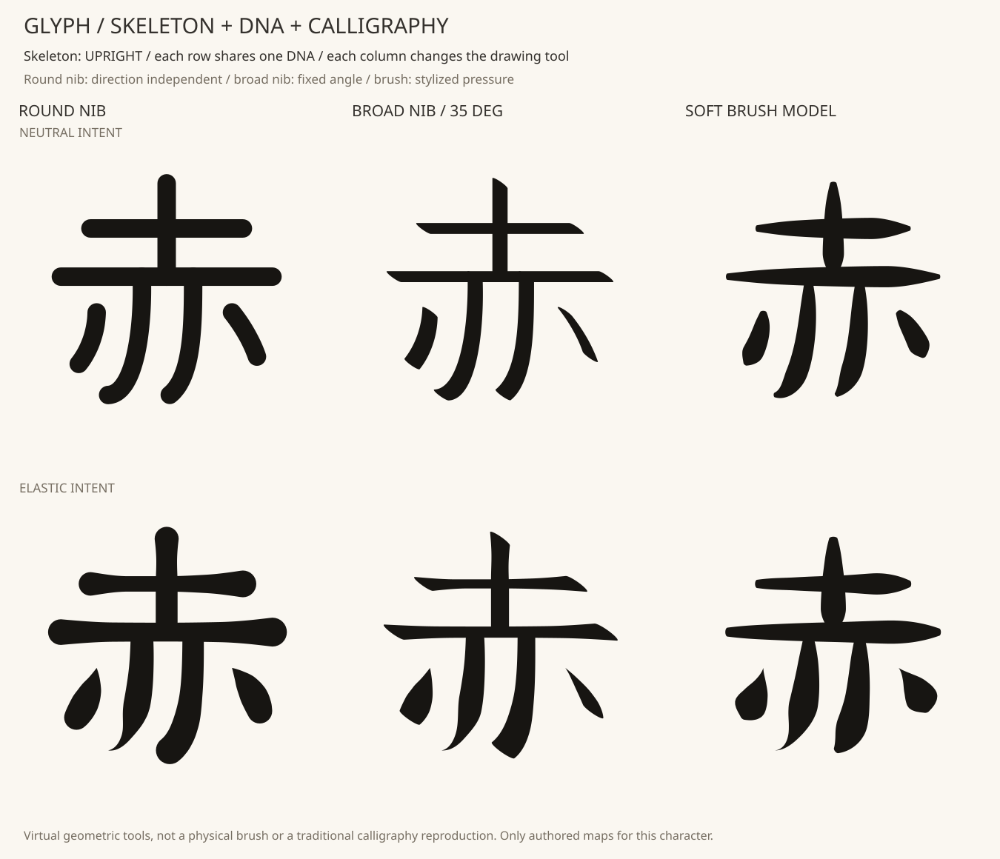
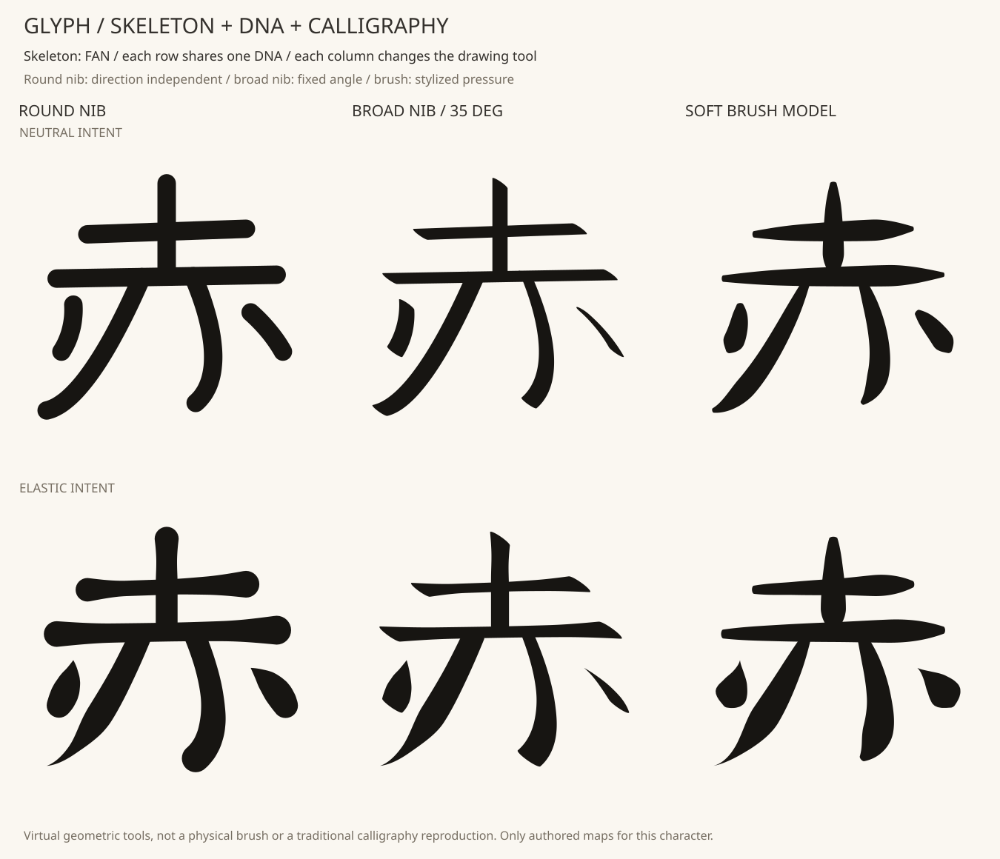

# 骨格 × DNA × カリグラフィー：三つの入力を組み合わせる

文字の構造、デザインの個性、描き方を別の入力として扱う初回の実装。
**自作の「赤」の骨格2種類 × DNA2種類 × 仮想の道具3種類＝12例**を生成した。
この研究では既存のゴシック系自作基本形を使用する。



列は丸芯・平ペン・毛筆風のモデル。上段は控えめなDNA、下段は端のふくらみと
先細りを持つDNA。図全体で骨格は同一、行ごとにDNAも同一。色と表示倍率も同じ。

## 三つの責任

| 入力 | 今回持つ情報 | 固定・変更の確認 |
|---|---|---|
| `SkeletonPlan` | 設計済みの7役割の中心線、基本形の太さ・先細り、出典 | 各図の全6例で同じ骨格ハッシュ・同じ制御点 |
| `LetterDNA` | 要求する太さの分布、位置、両側の配分、終端、重さ、元の特徴の継承度 | 同じ行の3例で同じDNAハッシュ・要求幅サンプル |
| `CalligraphyTool` | 接触面の形と向き、毛筆風の押し引き | 列ごとに道具ハッシュを記録し、太細と余白の変化を比較 |

`LetterDNA` に骨格や道具の欄はない。骨格は、前段で既存の `BoneRule` と接続規則を
適用してから `SkeletonPlan` にする。DNAから美的な骨格を自動設計する機能はまだ
追加していない。三つを独立に渡せる描画APIと、その比較が今回の実装範囲。

```python
plan = SkeletonPlan.from_source(source, bones)
svg, qa = draw_glyph(plan, letter_dna, drawing_tool)
```

旧 `AnatomyDNA`・旧renderer・既存bundle形式はそのまま使用できる。新しい研究は
独立したSVG出力であり、歌詞の出現IDや時刻を持つbundleへは未統合。

## 道具を幾何モデルとして表す

| 道具 | 接触面と描き方 | 輪郭で変わるところ |
|---|---|---|
| 丸芯 | 円形、方向による幅の変化なし | 控えめなDNAでは一画の途中が均一幅になる |
| 平ペン | 長短比0.18の楕円を固定35°で動かす | 線の向きで投影幅が変わり、曲線にも太細が生まれる |
| 毛筆風 | 長短比0.5の楕円を線の法線へ向け、押し引きの曲線で大きさを変える | 細く入り、途中で押し、終わりで抜く抑揚 |

角度はSVGの横軸から時計回り。楕円は接触面の近似であり、毛の物理・インクの流れ・
筆速による変形を再現するモデルではない。毛筆風の押し引きは、線の長さに沿って
手動指定した `[0.35, 0.85, 1.05, 1.15, 0.25]`。伝統的な書道の筆圧を計測した値ではない。

DNAの太さ分布は「要求」、道具が与える太細は「描き方」として別に記録する。
丸芯でもDNAにふくらみがあれば幅は変わるため、丸芯が常に均一幅という意味ではない。
平ペンでは接触面の向き、毛筆風では押し引きがさらに影響し、同じDNAから異なる
輪郭ができる。DNAの個性がどこまで保たれるかは、図で確認する研究対象。

平ペンの投影幅は、要求幅を `w`、線の法線を `n`、ペン先の長軸を `e`、長短比を
`a` として `w * sqrt((n·e)^2 + a^2 * (n·e_perp)^2)` になる。
水平・垂直線を実際に描いた幅と、この関係をテストで照合している。

## 輪郭の組み立てと検査

三次曲線を1025点で長さの表にし、そこから等間隔の129地点を求める。
DNAの太さと毛筆風の押し引きは、三次曲線のパラメータではなく**線に沿った長さの割合**
で評価する。各地点の接触面は32頂点。隣接する接触面を凸包で結び、合成して一画にする。

この新しいrendererは接触面の合成にBoolean演算を使用する。旧rendererの、法線に沿って
輪郭を直接組み立てる方式とは異なる。両方の方式を同じものとして扱わない。
平らな終端は端点の接線に対する半平面で切り、幅0の終端では接触面を点にする。
最終的な終端の印象には、直前の接触面の形や大きさも影響する。

0.01単位へ丸める際の輪郭誤差を0.0072以下、その後の既存の輪郭正規化も含めた
出力誤差を0.0173以下で検査する。無効な輪郭の自動修復は行わない。
共有した `inspect_layout` で、必要な接続・本体と左右の点の分離・最小余白も検査する。
不合格なら出力を拒否し、骨格やDNAを黙って変更しない。



図内の7役割は手動で指定したもので、正統な筆順・筆数を推定したものではない。
各役割は指定された中心線の始点から終点へ描く。役割間の運筆、空中の動き、筆順、
筆速、にじみ、かすれ、接合部の光学調整は今回のモデルに含めていない。

## 再現

```bash
python -m pip install -e ".[patterns]"
python -m flamoris_glyph.calligraphy_lab examples/aka-structure.json examples/calligraphy-study.json --out output-calligraphy-study
python -m unittest discover -s tests -v
```

`examples/calligraphy-study.json` に三軸を明示した。schema 1、kind `calligraphy-study-1`。
基本形はgothic/minchoから明示選択。骨格1〜4・DNA1〜4・道具1〜3、最大48例。
各軸のIDは重複不可、英小文字・数字・ハイフンの安全な名前を要求する。
骨格の指定は既存の骨格パターンと同じ形式。DNAと道具はそれぞれ別の厳密なschema。
実際には使わない道具設定も拒否する（例：丸芯への固定角度指定）。

出力は12個の輪郭SVG、比較図・中心線図、三軸それぞれの入力、出典と検査結果。
既存の出力先は拒否し、途中で失敗したディレクトリも公開しない。
同じ入力の再実行を比較する。描画エンジン・依存バージョンも記録する。

## 次に研究すること

三つの入力を切り分けて組み合わせる仕組みと、道具による幾何的な違いは確認できた。
文字が美しくなった、書道を再現できた、別文字でも個性が保てる、という判断はまだしない。
次は一画の入り・送り・抜きを役割ごとに研究し、手本の観察から押し引きや角度の
ルールを作る。骨格そのものの結構と、肉付け後の余白調整も別に研究する。

基礎研究の参考：

- [Paul Shaw：The Basics of Italic — Stress](https://www.paulshawletterdesign.com/2011/10/tutorial-no-5%E2%80%94calligraphy-the-basics-of-italic-2/)
  単線の骨格から平ペンによる太細へ進む教材。今回の35°や楕円モデルを規定するものではない。
- [毎日書道会：現代日本の書](https://www.mainichishodo.org/gendai/)
  形態・線質・律動・余白などを見て鑑賞する視点。

図形は自作骨格とこの幾何モデルから生成した。参考資料の図形をトレースしたデータではない。
