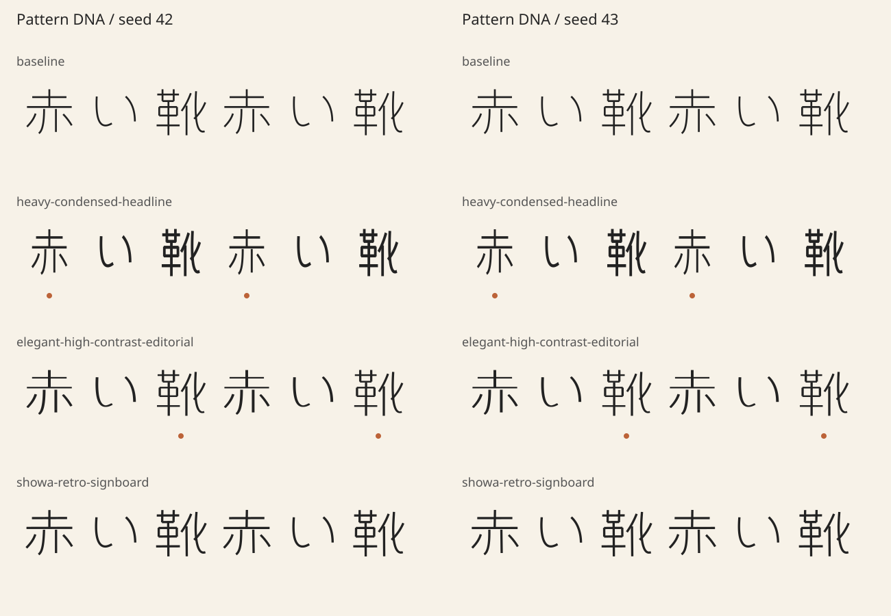

# First Pattern DNA experiment — 2026-11-01

Scope: initial bounded outline morphology, not finished display lettering.
No merge, deployment, font download or consumer change is part of this work.

## Source and reproduction

- Same original simplified 赤・い・靴・永 source for all profiles and seeds.
- Source: `examples/pattern-lab-skeletons.json`, Apache-2.0; flat terminals are
  explicit so the experiment does not inherit the older demo's hook overlaps.
- Same monochrome neutral Style DNA; source stroke width 28, variation 0.
- Baseline + three Pattern DNA profiles, seeds 42 and 43; seven occurrences in
  the small visual fixture. `detail.svg` enlarges the first six occurrences.
- Every matrix cell is independently compiled twice, then written and
  validated. Source/engine versions, hashes and per-variant warning records
  are in [the machine-readable result](../examples/pattern-lab-report.json).
- Reproduction command and full lyric command: [Pattern DNA guide](pattern-dna.md).

## Observations

| Profile | Seed 42 / 43 | Visual and geometry observation |
|---|---|---|
| baseline | 0 / 0 warned variants | Identical neutral source across both seeds |
| heavy-condensed-headline | 2 / 2 warned variants | Narrower, heavier; both 赤 occurrences reduce morphology to 0.5 to retain separate components |
| elegant-high-contrast-editorial | 2 / 2 warned variants | Directional thickness changes; both 靴 occurrences reduce morphology to 0.5 to avoid a topology change |
| showa-retro-signboard | 0 / 0 warned variants | Mild rounding/weight/irregularity; stylistic difference remains subtle |

Warning dots are deliberate: the system discloses a weaker transform rather
than treating a component merge as a successful full-strength result. Seed
differences are deliberately small and remain inside the same profile. The
mathematical fixture test additionally checks filled-area ratios (invariant
under global scaling) and directional stroke ratios, so differing output bytes
alone are not treated as evidence of meaningful transformation.

## Checks and remaining work

The automated suite includes legacy CLI/schema/golden fixtures; all three
profiles; exact fixed-seed regeneration; altered seeds; variation zero;
character reuse; font contours/curves/composites; winding and holes;
self-intersection rejection; topology/counter protection and explicit
reduction/rejection warnings; bundle metadata tampering; punctuation; and
complete 10-cue / 35-second / 88-occurrence lyric generation with an original
synthetic diagnostic font. Windows/Linux CI runs the same suite and publishes
the small original-source matrix as an artifact.

**Full Japanese visual acceptance is pending.** A Japanese font binary was not
available in the work environment. The full-lyric diagnostic font intentionally
maps characters to synthetic test shapes; it is not a substitution presented
as readable Japanese. No claims are made about 鏡/龍 legibility or 1080p
fine-line survival. The full lyric fixture and one-command comparison are ready
for a user-supplied static Japanese font and its license.

The editorial profile does not create serifs or understand terminals. The
retro profile needs a designed terminal grammar to become convincingly
signboard-like. Complex-script optical correction, target-size fine-line QA
and intermediate morph shapes remain Issue #6 work. The experiment establishes
reproducible, reusable pattern parameters and bounded diagnostics, not those
later capabilities.
