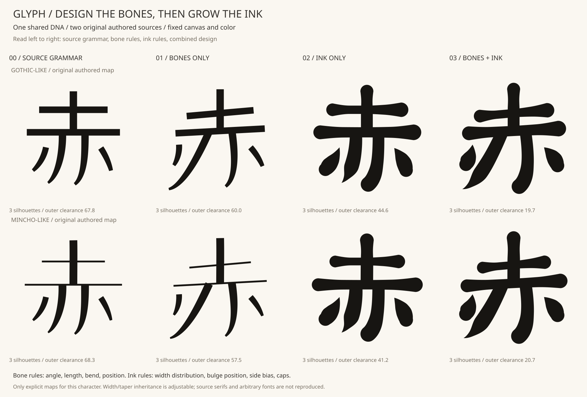
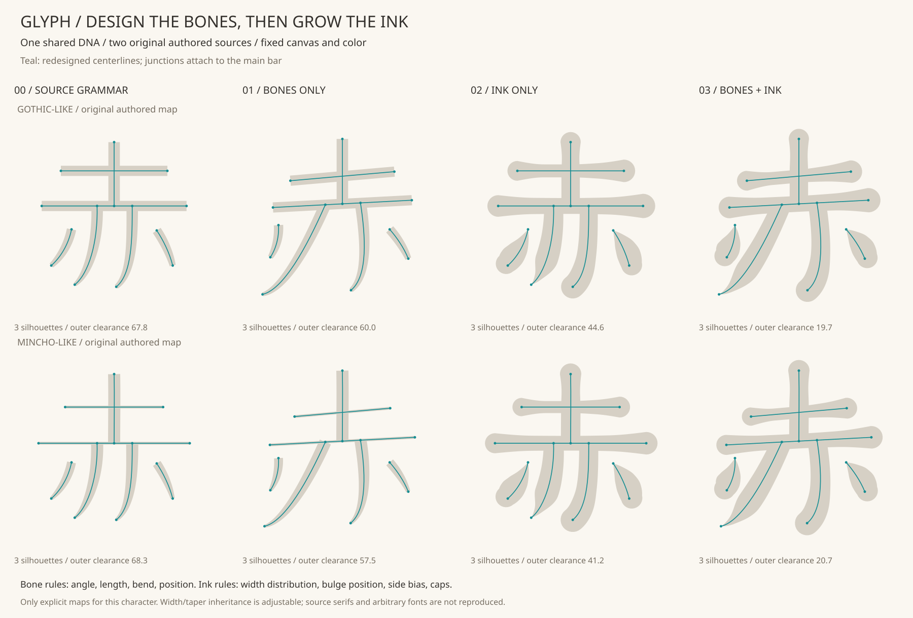

# 骨格を設計し、DNAで肉付けする「赤」の実験

基本形の輪郭を変形する代わりに、画の役割と接続を足場にして骨格を設計し、
新しい閉じた輪郭を作る。傾き・長さもデザインの一部として扱う。

**実装済み：一字の独立した研究用API / CLI。** 任意フォントからの骨格抽出、
他文字への汎化、美しさの自動評価は実装していない。既存のbundle生成器、
StructureDNA、プリセット、manifest形式は変更していない。



## 二つの層を分ける

| 層 | DNAで指定すること | この見本での使い方 |
|---|---|---|
| 骨格（BoneRule） | 各画の長さ、角度、曲がり、移動、変形の支点、終端方向 | 横画を右上がりにし、左の払いを大きく開く |
| 肉付け（InkRule） | 太さの分布、その位置、左右の肉の配分、両端の処理 | 横画の端をふくらませ、点をしずく形に、払いを尖らせる |
| 接続 | 明示した「赤」の接続規則 | 縦画の終点・内側二画の始点を、設計後の主横画に接続 |
| 余白の検査 | 最小距離、必要な接続、分離、囲まれた穴 | 本体と外側の点の融合、接続の欠落を失敗にする |

元データは `examples/aka-structure.json` の手動指定された7役割。
外側二つの点を接続しないことも規則に含む。7役割と3つの黒い連結形は異なる。
「SOURCE GRAMMAR」もこの接続規則を通すので、元データの輪郭をそのまま
再現した列ではない。明朝のうろこも描いていない。

骨格の接続は処理に明記した規則であり、自動の筆画推定や光学補正ではない。
余白は**検査**するが、自動で美しく配置し直す機能はない。違反時は出力を拒否し、
DNAを見直す。今回も払いを広げた際に点が近づきすぎた案を検出し、同じDNAを
両方の基本形へ適用して確認しながら、点の位置を手動で選び直した。

## 比較の読み方

同じ1000×1000の座標・色で、ゴシック系と明朝系の自作基本形を並べる。
画像ごとに拡大して差を隠す操作はしていない。

1. **SOURCE GRAMMAR**：元の太さ・先細りを使い、接続規則を適用。
2. **BONES ONLY**：傾き・長さ・払いの方向などを変更。肉付けは1と同じ。
3. **INK ONLY**：骨格は1と同じ。肉付けを変更。
4. **BONES + INK**：2の骨格と3の肉付けを組み合わせる。

これは層の違いを調べる比較であり、単一パラメータだけの美的効果を証明する
実験ではない。角度だけ・長さだけを変える知覚比較は次の段階になる。



輪郭は中心線上の129点に法線を立てて直接組み立てる。太さは位置を指定できる
5点間を単調な三次補間でつなぎ、点ごとに不必要なくびれが出るのを抑える。
丸い端は固定サンプルの半円、尖る端は幅0の端点で閉じる。各役割は単独の
閉じたパスを保つ。Boolean演算は接続・余白などの検査に限り、輪郭の生成には
使用しない。0.01単位の輪郭正規化と、書き出した輪郭の検査には既存処理を使う。

## 元の特徴を残す度合い

- `source_width_mix`：0はDNAの太さ比、1は基本形の縦・横・斜画の太さ比を使用。
- `source_taper_mix`：0はDNAの先細りのみ、1は基本形の終端の太さ比も反映。

両方とも0〜1。制御するのは**太さと先細り**であり、基本形全体の個性を
消す／残す万能のつまみではない。0でも骨格の元の比率と縦画の太さの基準値は
基本形に由来する。うろこなどの終端形状の継承は未実装。

同じDNAに対し、この二値を両方0・0.5・1にした6例もCLIで生成する。
これらは二つの値を同時に動かす対照であり、それぞれの効果を分離した実験ではない。

## 再現

```bash
python -m pip install -e ".[patterns]"
python -m flamoris_glyph.anatomy_lab examples/aka-structure.json examples/anatomy-dna/elastic-retro.json --out output-anatomy
python -m unittest discover -s tests -v
```

`out` は未使用のディレクトリを指定。8例のSVG、継承度の6例、比較図2枚と
`report.json` を生成する。失敗途中のディレクトリは公開しない。研究用SVGは
既存と同じ1000×1000のパスのみの形式だが、出現IDや歌詞時刻を持つbundleには
まだ組み込んでいない。

DNAのJSONはschema 1、kind `role-anatomy-study-1`。7役割すべてのbone/ink欄を
明示し、不明な欄や欠落、非数、範囲外を拒否する。角度の正方向はSVG座標で
時計回り。`bend` は元の始終点を結ぶ線の法線方向。`end_turn` は最終ハンドルの
向きを追加で回す。長さや角度の操作後に主横画への接続を適用するため、指定した
変倍率が最終的な端点間距離の倍率にそのまま一致するとは限らない。

Python APIは `design_glyph(AuthoredStructureSource(data, base), AnatomyDNA)`。
戻り値はSVG文字列とQA情報。固定入力で再現できる。ランダムな出現ごとの変化や
新しいseed機能は、この実験には追加していない。

## 現時点で判断できること

骨格だけ／肉付けだけを切り分けて試せる仕組みができた。元のフォント輪郭を
一律に膨張させる方法より、画の役割ごとに描き分けるための指定が増えた。
ただし、このレシピがお手本の魅力を十分に再現できたかは、見た目で確認する
段階にある。以前の[お手本の輪郭研究](../research/retro-aka-reference/README.md)と
同様、幾何の検査結果を美しさの判定には使わない。

見た目の残課題もある。BONES ONLY列の明朝系では、斜めになった太い払いの
付け根が細い主横画から少し突き出す。接続が成立しても、その輪郭が滑らかに
見えるとは限らない。接合部の輪郭を整える処理は、余白の自動調整とともに
今後の研究対象とする。

次の課題は、愛乃の判断で残す特徴を選び、ルールを固定して「い」「靴」など
別文字へ適用すること。自作の二つの基本形で動いたことを、実フォント一般への
対応や、デザインの汎化が成立した証拠として扱わない。
