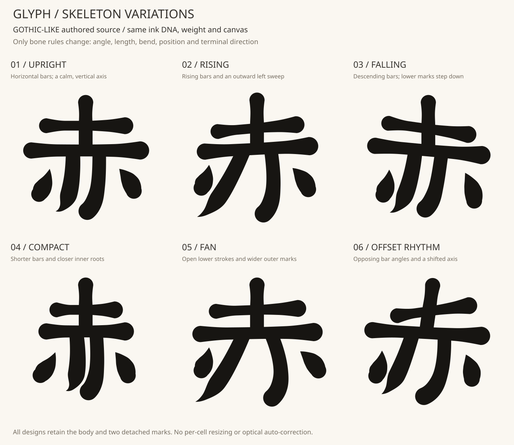
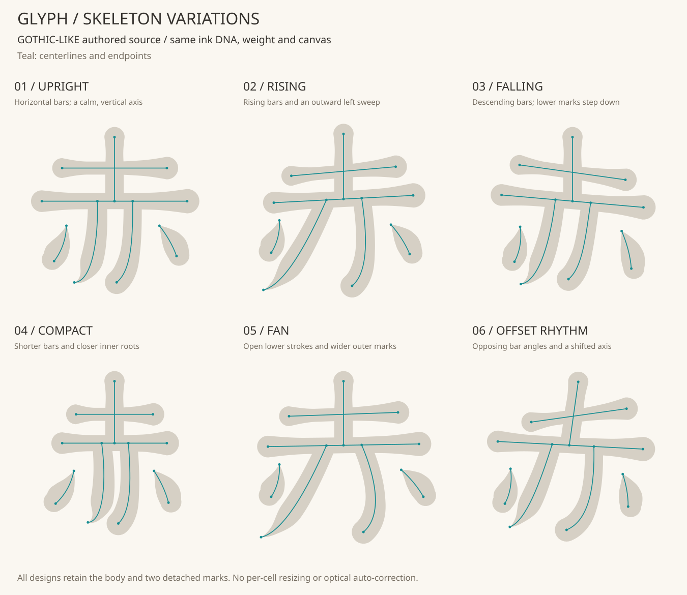
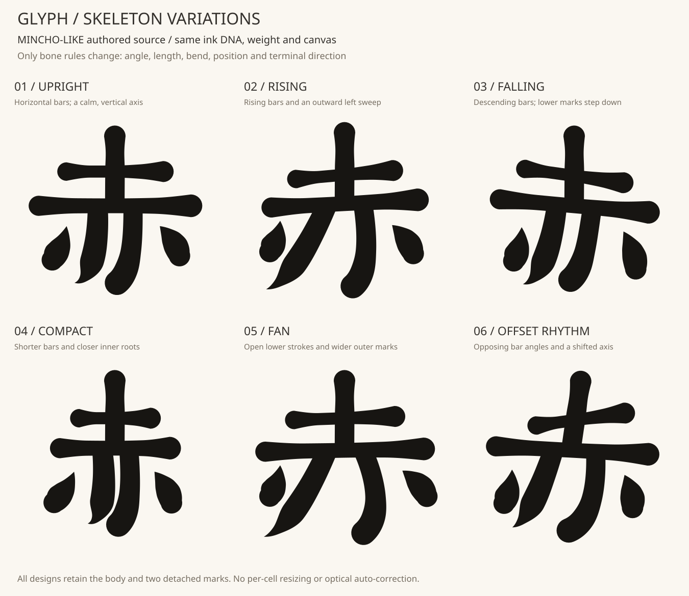

# 肉付けを固定し、骨格の6パターンを比べる

画の傾き・長さ・配置の違いが文字の表情へどう関わるかを見るため、
肉付けを同じ設定にした6種類の骨格を、自作のゴシック系／明朝系の基本形へ
適用した。**「赤」一字、6パターン×2基本形＝12例の研究**。



| 番号 | 骨格 | 主な指定 | 見比べるところ |
|---|---|---|---|
| 01 | 直立 | 横画は水平、中心は垂直 | 基準になる立ち姿 |
| 02 | 右上がり | 横画は−5°／−3°、左払いを外へ | 上へ向かう線と払いの広がり |
| 03 | 右下がり | 横画は＋8°／＋5°、右の点を下へ | 左右の高さの違い |
| 04 | 凝縮 | 横画の長さを0.72倍、内側の根元を寄せる | 横幅と内側の白い空間 |
| 05 | 扇状 | 内側の払いを左右へ開き、点も外へ | 下側の広がりと重心 |
| 06 | ずらしたリズム | 上の横画−8°、主横画＋3°、縦の軸も傾ける | 画どうしの向きの対比 |

角度の正方向はSVG座標で時計回り。数字は入力した骨格ルールであり、接続規則を
適用した後の全画の傾き・端点間距離を単純な一括変形で表すものではない。
各案は複数の骨格パラメータを変えている。角度だけの美的効果を測る実験ではない。

## 固定したもの

- `examples/anatomy-dna/elastic-retro.json` の肉付け：5点の太さ分布とその位置、
  端の処理、左右の肉の配分、weight、元の太さと先細りの継承度。
- 色、1000×1000の座標、図内の表示倍率。
- 画の接続規則、点と本体の分離、最小余白の検査。

**各基本形の中で、局所の太さサンプルは全6案で一致**する。設定のハッシュと
サンプルを実行時に比較し、肉付けが変わったら失敗にする。線が長くなれば黒い
面積も変わるので、見かけの太さや総面積まで同一という意味ではない。
基本形の縦横比や太さの違いは残るため、二つの基本形の間では幅の数値も異なる。



## 明朝系にも同じ骨格ルールを適用



これは実フォントの比較ではなく、手動で用意した二つの基本形の比較。
うろこを再現する処理や、任意フォントから画を抽出する処理は追加していない。
元の基本形とDNAを取り違えないよう、出典と入力のハッシュを記録する。

## 再現・編集

```bash
python -m pip install -e ".[patterns]"
python -m flamoris_glyph.skeleton_lab examples/aka-structure.json examples/anatomy-dna/elastic-retro.json examples/skeleton-patterns.json --out output-skeleton-study
```

出力には12個の閉じた輪郭SVG、基本形ごとの比較図と中心線入り図、6個の解決済み
DNA、入力スナップショットとレポートを含む。出力先が存在したら拒否し、途中で
失敗した出力は残さない。歌詞の時刻・出現IDを持つbundleへの統合は行っていない。

`examples/skeleton-patterns.json` はschema 1、kind `authored-skeleton-patterns-1`。
各案に `id`・`title`・`note`・7役割分の `bones` を明示する。1〜9案まで。
IDは重複不可、英小文字から始まる英小文字・数字・ハイフンのみで最大31文字。
各bone欄は `BoneRule` の全フィールドを持つ。不明な欄や肉付けの上書きは拒否。
骨格の設定自体の範囲は[骨格と肉付けの仕様](role-anatomy-study.md)に従う。

再編集するときは角度・長さなど一つの変更から試し、図で接合部と白い隙間を
確認する。特に06の初期案では左の点が本体へ接触したため、点を外側へ移す
骨格指定を手動で選び直した。自動で美しい位置を探索した結果ではない。

## この研究でまだ決めないこと

幾何の検査は、画のつながり・分離・有効な輪郭を確かめるもの。どの案が素敵か、
読みやすいか、曲に合うかは別に見て選ぶ。接合部の光学的な整形、他文字への
汎化、映像サイズでの読みやすさも未検証。6案の優劣を数値で順位付けしない。
