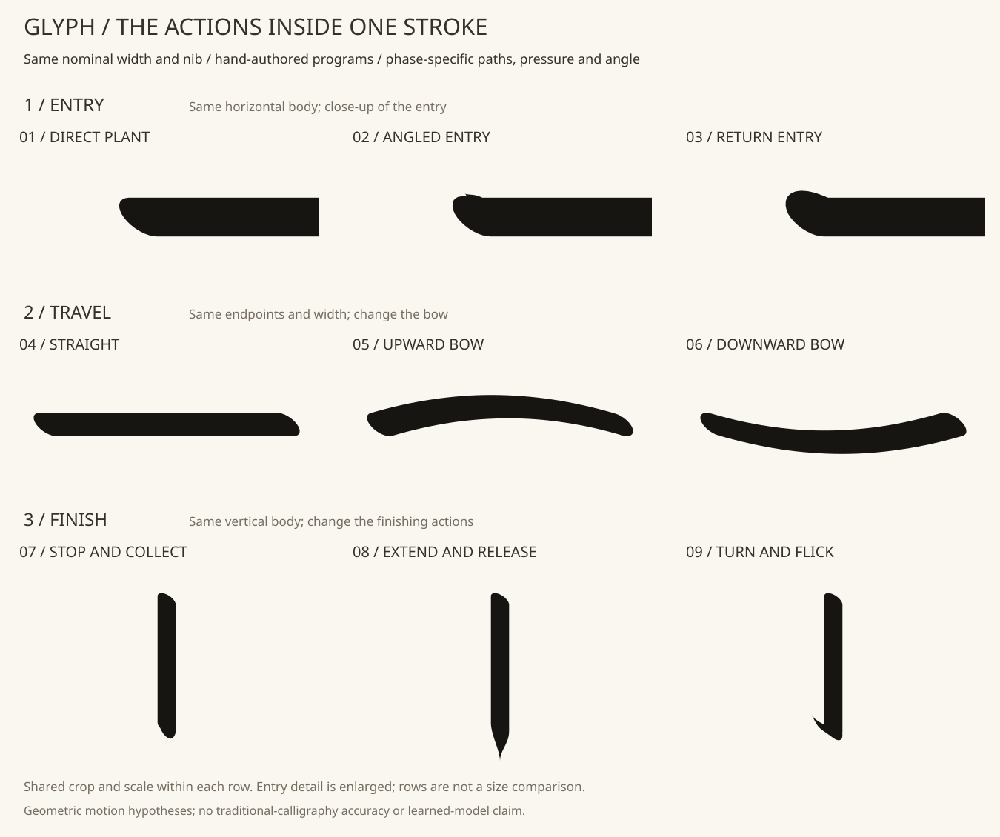
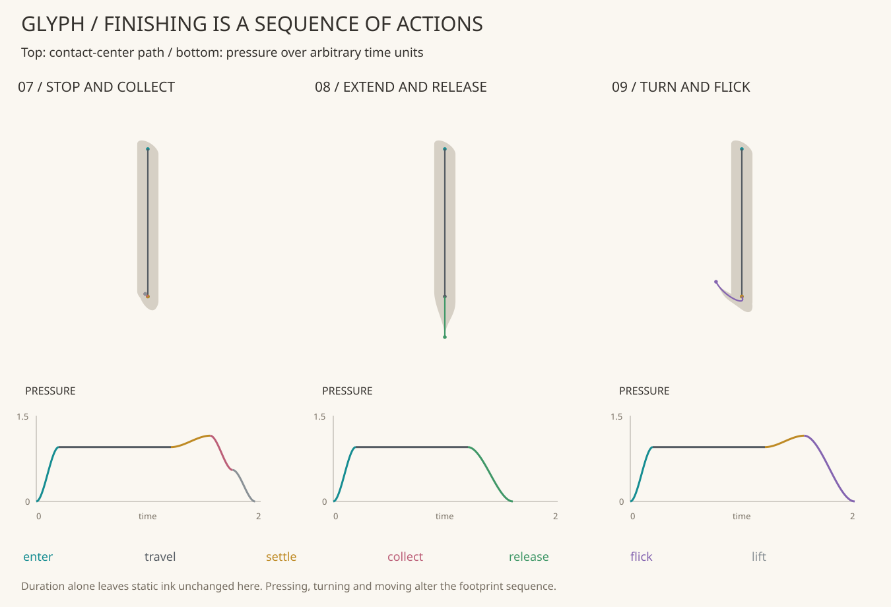

# 一本の線の入り・運び・収めを研究する

従来の毛筆風モデルは全画に共通の押し引き曲線を与えていた。
今回は一画を複数の動作フェーズとして手動で記述し、経路・押し引き・筆先の角度を
同時に変える。**一画の語彙を作る初回の研究**であり、文字全体へはまだ適用していない。



| 比較 | 固定する部分 | 変える部分 |
|---|---|---|
| 01〜03：入り | 横画の本体・終わり | 直接置く、斜めから入る、戻って入る動作 |
| 04〜06：運び | 始終点、入り・終わり | 直進、上への弓形、下への弓形 |
| 07〜09：収め | 縦画の本体 | 押して収める、伸ばしながら抜く、方向を変えて跳ねる |

公称幅70・楕円の長短比0.5は全例共通。入りは拡大図、運びと収めは別の共通表示範囲。
**各行の中で同じ切り抜きと倍率**を使う。行どうしの大きさを比べる図ではない。
01と04は同じ基準動作を、別の比較の基準として再掲している。

「斜め入り」などの名前は、今回の手動の動作テンプレートに付けた注釈。
書道の筆法を正確に習得・再現したことや、教師として正しい教材であることは未確認。
形の優劣は図を見て判断する。

## Stroke Program の最小表現

`StrokeProgram` は1〜8個の `StrokePhase` を持つ。各phaseは以下の数値を明示する。

- `action`：enter / travel / settle / collect / release / flick / lift。
- `points`：接触中心の三次曲線4点。stationaryな動作は4点を同位置にする。
- `pressure`：開始・終了の接触面スケール（0〜1.5）。0は離筆。
- `angle`：筆先楕円の開始・終了角度（SVG横軸から時計回り、−180〜180°）。
- `duration`：0.05〜5の任意時間単位。実際の筆速を計測した秒数ではない。

前phaseの終わりと次phaseの始まりで、位置・押し引き・角度の連続性を要求する。
始めはenterかつ接触0、終わりは接触0。一画の途中で離筆してから別の接触を
始めるプログラムは拒否する。settleは接触中心を移動させない。liftは接触0で終える。

各phaseを33地点で評価し、圧と角度を滑らかに補間する。接触面は32頂点の楕円。
隣り合う接触面を凸包で結んで合成する。接触0どうしの空中移動は描画しない。
出力は一つの有効な閉じた輪郭に限定し、既存の0.01単位の輪郭正規化と、最大
0.0173単位の境界誤差の検査を再利用する。無効な輪郭や範囲外は拒否する。

`action` の文字列だけで専門的な動作が生成されるわけではない。
**パターンは数値を持つ動作列そのもの**。将来、どのパターンを選び、数値をどう
調整するかを教育するためにも、動作の注釈と実際に描いた軌跡を保存する。

## 止め・払い・跳ねは先端形状の切り替えだけではない

今回の例では、次のような動作列を明示している。

- 止めの仮説：入り → 運ぶ → その場で押して回す → 少し戻して収める → 離す。
- 払いの仮説：入り → 運ぶ → 先へ伸ばしながら接触を小さくして離す。
- 跳ねの仮説：入り → 運ぶ → 押して筆先を回す → 向きを変えて接触を小さくし、離す。



ここで重要なのは時間と形の区別。**ためる時間だけを4倍にしても、静止SVGは同じ**に
なる対照を保存した。時間の変化はtraceに反映されるが、このモデルには滞在時間に
よる墨の増加や筆毛の粘弾性がないので、待つだけで形が変わるとはしない。

もう一つの対照では、押す・回す変化を取り除き、他の経路と時間を固定した。
こちらは静止SVGと面積が変わる。二つの変更を同時に除いた対照であり、押す効果と
回す効果を個別に評価した実験ではない。面積の増減も、美しさの点数ではない。

## 再現と結果

```bash
python -m pip install -e ".[patterns]"
python -m flamoris_glyph.stroke_lab examples/stroke-program-study.json --out output-stroke-study
python -m unittest discover -s tests -v
```

出力は9例＋2対照のSVGとプログラム、比較図2枚、入力スナップショット、レポート。
schema 1、kind `stroke-program-1` で一画、`stroke-program-study-1` で固定の9例比較を
記述する。未知欄、非数、範囲外、不連続な状態、複数の接触runを拒否する。
既存出力先を上書きせず、失敗途中のディレクトリも公開しない。

レポートには動作ごとの時刻・位置・圧・角度、プログラムのhash、描画結果を含む。
横画・縦画それぞれに共通の祖先グループを記録した。これらの近い変種を将来の
学習/評価へランダムに分けて、汎化ができたと解釈しない。

今回は新しい一画の研究APIであり、既存の文字renderer・SkeletonPlan/LetterDNA・
歌詞bundleへ自動適用する機能はない。かすれ・にじみ・筆毛・筆速による線幅変化も
扱っていない。形の魅力、筆法の正確さ、文字へ組み上げた時の読みやすさは今後の研究。

## 将来の「文字を書くAI」への関係

[Issue #9](https://github.com/flamoris-jp/flamoris-glyph/issues/9)に、Maidionis派生の
文字専門AIの研究を切り出した。今回の動作列はその入力出力候補・baselineの材料に
なるが、教師として承認したデータではない。Maidionisのfork作成や訓練は行っていない。
人が確認した動作例・失敗例・比較評価を集め、上限付きの動作列を学ぶ課題へ進める。

参考：[横浜市教育センター・書写指導サポートブック](https://www.edu.city.yokohama.lg.jp/tr/ky/hamaup/theme04/docs/syosya/20230801syosya.pdf)。
始筆・送筆・終筆や、穂先の動きと点画のつながりを重視する指導を参照した。
今回の曲線・圧・角度は自作の幾何的な仮説であり、資料の手本をトレースした数値ではない。
