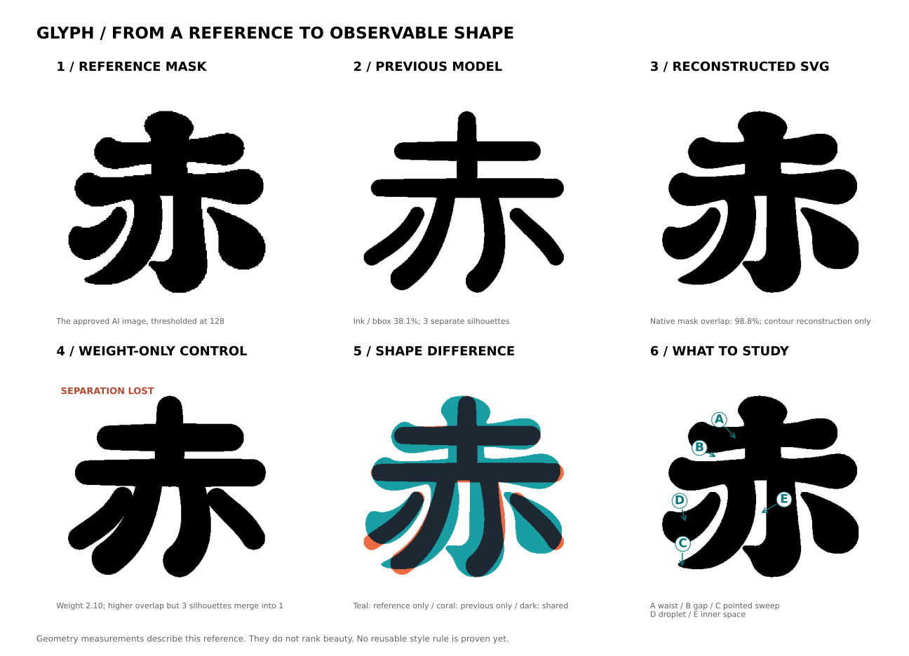

# レトロな「赤」：お手本の形から特徴を捉える研究

目的は「素敵に見える形の特徴をどう捉えるか」。動く変形処理やテスト成功を、
造形の成功とは扱わない。この研究では、愛乃が気に入ったAI生成のお手本を
輪郭として再構成し、以前の出力と比較した。



## 今回できたこと

- お手本画像から「赤」一字の領域を手動指定し、閾値128の二値マスクを作成。
- インストール済みの外部Potrace 1.16で輪郭をBezier曲線へトレース。
  フォントや外部ストローク辞書は使用・取得していない。
- 元のマスクに対するSVGの重なり率（IoU）は約 **98.8%**。離れた黒い形も
  **3つとも保持**した。これは形の写し取りの精度であり、美しさの点数ではない。
- 比較は高さ820・外接矩形の中心[500,500]へ等方拡大縮小するだけ。
  パーツを動かして差を隠したり、縦横比を別々に合わせたりしていない。
- 「太さだけ増やす」対照実験も作成。変形器の他の設定は固定した。

`reference-trace.svg` は輪郭の研究用見本。**このトレース自体は再利用可能な
DNAではなく、意味を持つ7筆への分解でもない。** 3つの連結した黒い形と
筆画の数を混同しない。

## 形を見直して分かったこと

以下の数値は、この「赤」で手動選択した測定位置に限る。文字一般の定義や
「この値なら美しい」という基準ではない。詳細は `shape-report.json` に記録。

| 観察項目 | お手本のトレース | 前のモデル | 太さだけ増やした対照 |
|---|---:|---:|---:|
| 外接矩形内の黒い面積 | 57.4% | 38.1% | 52.7% |
| 字幅 / 字高 | 1.083 | 1.105 | 1.090 |
| 横画の左端寄り / 付け根寄りの厚み | 1.37 | 0.91 | 0.90 |
| 横画間の白い隙間 / 字高 | 4.9% | 10.2% | 4.9% |
| 離れた黒い形の数 | 3 | 3 | **1（分離を喪失）** |
| お手本トレースとの形状IoU | — | 62.6% | 75.8% |

全体の縦横比は近い。一方、黒い面積、どこをふくらませるか、白い隙間の
形が違った。特に前のモデルは横画の中央寄りをふくらませていたが、お手本は
丸い端から付け根へくびれている。単に「丸みが足りない」と捉えるだけでは、
変える方向まで取り違える。

太さだけを増やすと上の隙間の量は近づいた。しかし、別れているべき点と
本体まで接続した。形のIoUは上がっても、白い分離が失われる。この結果を
「良くなった字形」とは判定していない。

## お手本で効いている、と考える特徴

比較図のA〜Eは手動の観察点であり、自動認識した筆画ではない。

| 観察点 | 見えている形 | 次に検証する仮説 |
|---|---|---|
| A：横画のくびれ | 丸く太い端から、細い付け根へ変化する | ふくらみの位置・幅・強さを独立に指定すると、弾力のあるリズムが出るか |
| B：上の白い隙間 | 狭いが、湾曲した輪郭によってつぶれずに残る | 上部を密にしながら局所の白い通路を守る必要があるか |
| C：左下の払い | 幅広く扇状に広がり、最後は尖る | 丸い重さに鋭い払いを組み合わせると、動きが出るか |
| D：左右の点 | 一定幅の棒ではなく、非対称なしずく形 | 点にも太さの分布と向きを与えると、全体との一貫性が出るか |
| E：内側の白い形 | 輪郭が互いを受けるように曲がっている | 各線だけでなく、線どうしが作る白い形を制約として持つ必要があるか |

この見本の魅力についての**仮説**は、丸いふくらみと尖った払いの対比、
黒い重さと白い通路の釣り合いにある。一律の丸めや一律の太字では、その
配置まで表せない。仮説を一般的な美しさの法則として扱わない。

## DNA設計へ戻す前の研究項目

`reference-features.json` は観察と仮説の記録であり、現在のエンジンへ入力する
設定ではない。新しい機能を実装済みと見せるための数値は追加していない。

1. ふくらみの**位置・長さ・左右差**と、端の丸さを分ける。
2. 終端処理を筆画の役割ごとに選ぶ。丸い横画、尖る払い、大きな丸い足を併存させる。
3. 白い隙間を領域ごとに扱い、上を詰めても下の分離を守れるか試す。
4. 一度に一つの特徴だけを変える比較を作り、同じサイズ・色で見た印象を確かめる。
5. 「赤」で選んだルールを固定してから、同じお手本中の「い」「靴」を別文字の
   検証対象にする。各文字をトレースして並べるだけでは汎化の証明にならない。

今回はこの準備まで。別文字への適用、任意フォントからの構造抽出、最終映像の
サイズでの可読性、学習による特徴抽出はまだ実装・検証していない。

## 再現と出典

```bash
python -m pip install -r research/retro-aka-reference/requirements.txt
python research/retro-aka-reference/study.py --out output-reference-study
```

このスクリプトは保存済みマスクとSVGから測定・図を再生成する。外部画像の
自動切り抜きや新規トレースは行わない。追加依存は研究用で、Glyph本体の
依存関係・生成器・プリセットは変更していない。

- 元絵：この会話で作成したAI生成の文字デザイン見本「赤い靴・文字デザイン3変奏.png」。
- 元絵のハッシュ、切り抜き座標、閾値、トレース条件：`source-provenance.json`。
- 正解を再構成するためのBezier輪郭：`reference-trace.svg`。
- 閾値128のマスク（行ごとの黒画素区間）：`reference-mask.json`。
- 比較元：PR #8、コミット `c2482c412bfd0ef9dd18854836341499b24175d7` の
  自作ゴシック系基本形＋レトロDNA、seed 42、最初の「赤」。
- 太さだけの対照の選択条件：`weight-only-control.json`。重なり率を最大にする
  サンプルを選んだが、分離喪失のため、字形としての成功例ではない。
- 外部トレースツールの仕様：[Potrace Library API](https://potrace.sourceforge.net/potracelib.pdf)。
  ライブラリやトレース用バインディングはこのリポジトリへ同梱していない。

マスクからSVGへ戻した際の重なり率、3つの分離の維持、対照の分離喪失は
研究スクリプトの実行時に検査する。既存のGlyph用48テストとは役割が異なる。
